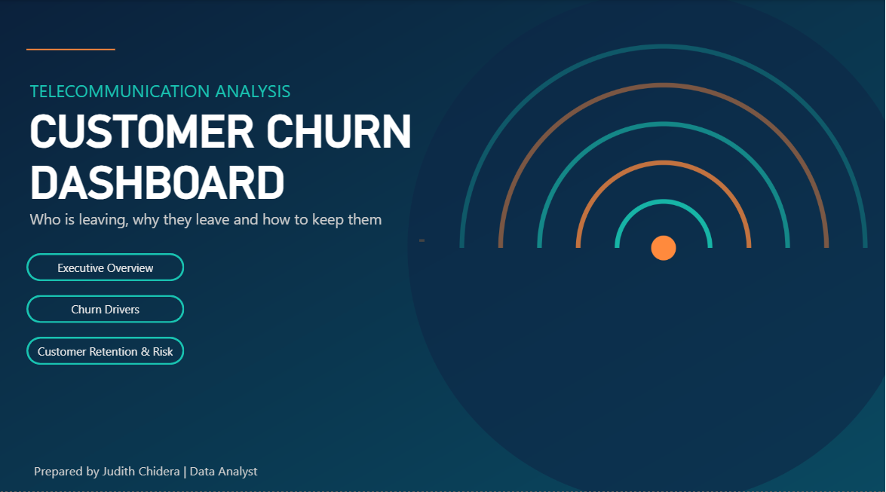
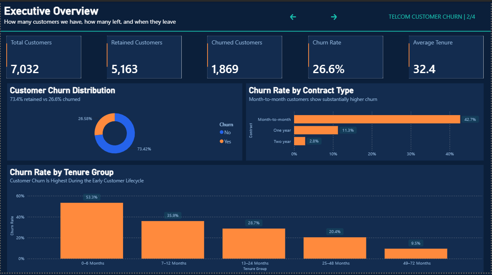
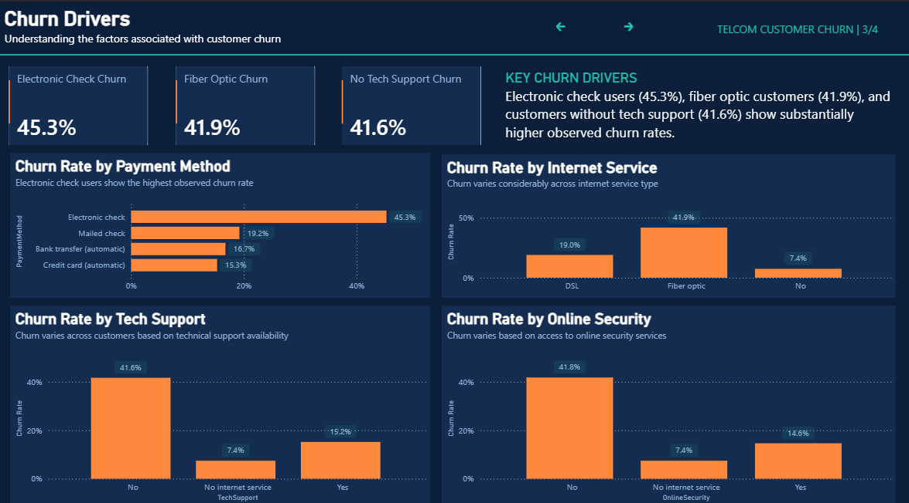
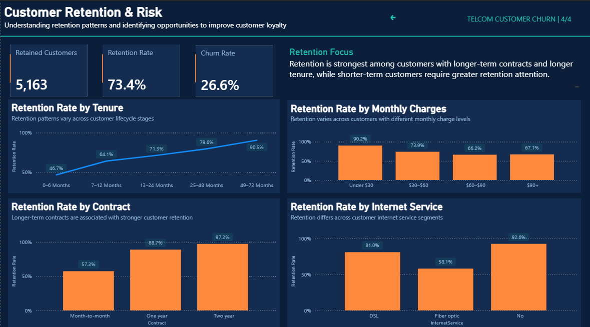

# Telecom Customer Churn Analysis

An interactive Power BI dashboard that shows how many telecom customers leave, which customer segments leave most often, and where retention efforts should be focused.






## Dataset
IBM Telco Customer Churn sample dataset (`WA_Fn-UseC_-Telco-Customer-Churn.xlsx`), a public dataset widely available on Kaggle. A copy is included in this repository as `Telcom-Customer-Churn.xlsx`.

**Data preparation (Power Query):** column types were set, and the 11 rows with a blank `TotalCharges` (customers with zero tenure) were removed. The analysis covers **7,032 customers**, of whom **1,869 churned**.

## Dashboard pages

### 1. Executive Overview: *What is happening with churn?*
- KPIs: total, retained and churned customers, churn rate, average tenure
- Churn distribution, churn by contract type, churn by tenure group

### 2. Churn Drivers: *Which customer characteristics are associated with higher churn?*
- Churn by payment method, internet service, tech support and online security
- KPI cards for electronic check, fiber optic and no-tech-support churn

### 3. Customer Retention & Risk: *Where is retention strongest or weakest?*
- Retention by contract, internet service, monthly charges and tenure
- Retention KPIs

## Key findings
| Segment | Churn rate |
|---|---|
| All customers | 26.6% |
| Month-to-month contract | 42.7% (one-year 11.3%, two-year 2.8%) |
| Electronic check payers | 45.3% (other payment methods 15-19%) |
| Fiber optic internet | 41.9% (DSL 19.0%) |
| No tech support | 41.6% (with tech support 15.2%) |
| No online security | 41.8% (with online security 14.6%) |
| Tenure 0-6 months | 53.3% (49-72 months 9.5%) |
| Monthly charges under $30 | 9.8% ($60-$90 band 33.8%) |

> These are observed associations, not proof of causation. Several factors overlap (for example fiber optic customers and customers without tech support), so no single factor should be read as *the* cause.

## Tools
Power BI Desktop, Power Query, DAX, Microsoft Excel

## Repository structure
```text
├── churn.pbip              # open this file in Power BI Desktop
├── churn.Report/           # report pages and visuals
├── churn.SemanticModel/    # data model, DAX measures and calculated columns (TMDL)
├── Telcom-Customer-Churn.xlsx  # source dataset
├── Screenshots/            # dashboard previews
├── README.md
├── PROJECT_SUMMARY.md
└── .gitignore
```

## How to run it
1. Clone or download this repository.
2. Open `churn.pbip` in Power BI Desktop.
3. Go to **Home → Transform data**, open the `Telcom` query's **Source** step and point it at `Telcom-Customer-Churn.xlsx` in the folder you downloaded (the saved path is specific to the original author's computer).
4. Click **Close & Apply**, then **Refresh**.

## Skills demonstrated
Data cleaning, data modeling, DAX, KPI design, customer segmentation, exploratory analysis, dashboard design and data storytelling.

**Created by Anyaegbu Judith Chidera**
